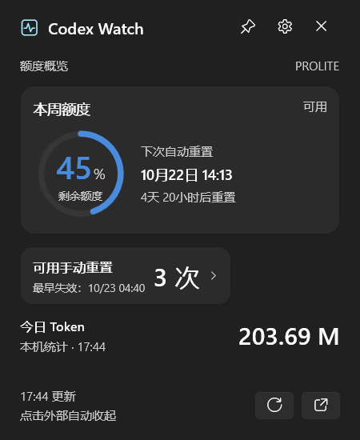
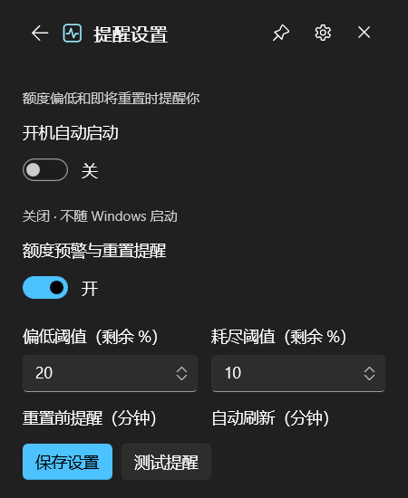

<p align="center">
  
</p>

<h1 align="center">Codex Watch</h1>
<p align="center">在任务栏，看见你的 Codex 额度。</p>
<p align="center">C# · WinUI 3 · Windows 11 · 免安装</p>

<p align="center">
  <strong><a href="https://github.com/zhxil/CodexWatch/releases/latest">下载 Windows x64 版</a></strong>
  &nbsp;·&nbsp; <a href="#界面">实机截图</a>
  &nbsp;·&nbsp; <a href="#使用">使用说明</a>
  &nbsp;·&nbsp; <a href="#从源码构建">从源码构建</a>
</p>

额度、重置与用量，一眼可见。Codex Watch 将剩余额度和今日本机 Token 用量放进 Windows 任务栏；悬停查看重置时间，单击展开详情，也可以固定成桌面悬浮面板。

## 界面

**日常看一眼，详情点一下。** 任务栏胶囊常驻显示，不需要一直展开窗口。

<p align="center">
  
</p>

<p align="center">
  
</p>
<p align="center"><sub>圆环额度概览 · 重置倒计时 · 今日 Token · 一键固定到桌面</sub></p>

<br />

<table>
  <tr>
    <th width="50%">悬停，提前掌握重置时间</th>
    <th width="50%">提醒，按你的节奏设置</th>
  </tr>
  <tr>
    <td align="center" valign="top"></td>
    <td align="center" valign="top"></td>
  </tr>
  <tr>
    <td>鼠标停留即可查看自动重置时间与逐份失效明细，无需切换当前窗口。</td>
    <td>集中管理开机启动、预警阈值、重置前提醒、刷新周期和免打扰。</td>
  </tr>
</table>

截图来自 Windows 11 上实际运行的 v1.0.0，展示深色界面；额度、时间和用量随账户变化。

## 功能

- **任务栏摘要**：紧凑胶囊显示剩余额度与今日 Token，支持额度预警配色。
- **悬停卡片**：显示自动重置时间、倒计时、可用手动重置次数和各份机会的失效时间。
- **桌面面板**：圆环展示剩余额度，支持图钉固定、拖动移动与浅色／深色主题。
- **额度与到期提醒**：支持低额度预警、重置前提醒、手动重置机会到期提醒与免打扰。
- **后台常驻**：可在设置中开启当前用户的开机启动，单实例避免重复运行。
- **本机统计**：独立读取今日会话 Token 用量，账户同步失败时保留当天最近一次有效统计。

## 使用

1. 从 [Releases](https://github.com/zhxil/CodexWatch/releases/latest) 下载 Windows x64 ZIP，完整解压到固定位置。
2. 先安装并登录 Codex，再双击 `CodexWatch.exe`。请保留同目录下的运行库和资源文件。
3. 悬停任务栏胶囊查看摘要，单击展开详情；点击图钉固定面板，点击齿轮打开设置。
4. 需要随 Windows 启动时，在设置中开启“开机自动启动”。移动程序目录后，请在新位置重新开启。

面向 Windows 11 x64。便携包自带 .NET 和 Windows App SDK 运行时，使用时无需安装开发工具或另装 .NET。找不到 Codex 时，可设置环境变量 `CODEX_EXE` 为 `codex.exe` 的完整路径。

| 操作 | 行为 |
| --- | --- |
| 悬停任务栏胶囊 | 查看额度、自动重置与手动重置失效时间 |
| 单击任务栏胶囊 | 展开额度详情 |
| 点击图钉 | 固定／取消固定桌面悬浮面板 |
| 点击窗口外部 | 收起未固定的面板 |
| 关闭按钮或 `Esc` | 收起面板；在设置页按 `Esc` 返回概览 |
| 右键任务栏胶囊或托盘图标 | 刷新、打开官方用量页或退出程序 |

## 数据与隐私

额度和套餐通过本机 `codex app-server` 的 `account/rateLimits/read` 读取，登录凭据由 Codex 管理；本工具不会读取、复制或保存登录 token，也不会将用量上传到第三方。

今日 Token 来自本机 Codex 会话记录，包含已记录的输入与缓存等用量，不代表账户整体计费额度。可用手动重置次数与失效时间以服务端返回为准，缺失信息会明确显示为未知；本工具不直接使用手动重置机会。

## 从源码构建

在 Windows 上安装 .NET 10 SDK。WinUI 与 Windows App SDK 依赖通过 NuGet 还原。

```powershell
git clone https://github.com/zhxil/CodexWatch.git
cd CodexWatch

# 自包含发布，输出到 dist/winui3-win-x64。
./winui/publish.ps1

# 运行提醒阈值、去重、免打扰和失效时间等策略检查。
dotnet run --project verification/AlertPolicyChecks.csproj
```

可向发布脚本传入 `-Dotnet <dotnet.exe路径>` 或 `-OutputDirectory <输出目录>`。SDK、依赖缓存、本机配置、诊断记录与构建产物不进入 Git；可运行的便携包放在 GitHub Releases。

## 项目结构

```text
winui/                       当前 WinUI 3 界面、任务栏、提醒与设置
CodexAppServerClient.cs       Codex app-server 通信与额度解析
verification/                提醒策略检查与窗口截图工具
docs/screenshots/            Windows 实机截图
avalonia/                    保留的 Avalonia 版本
根目录其余 C# 文件            保留的 WinForms 版本
```

## 兼容性与验证

已在当前 Windows 11 机器上验证便携包解压启动、任务栏摘要、悬停不抢焦点、详情和设置交互，并通过 24 项提醒策略检查。

任务栏嵌入目前面向主屏、水平、居中的 Windows 11 任务栏，不属于官方扩展点；左对齐时保留托盘入口。多屏、自动隐藏任务栏及干净虚拟机兼容性尚未完成完整验证。开机启动已验证快捷方式与系统识别，尚未完成真实重启登录验证。

更多提醒配置与实现说明见 [WinUI 3 文档](winui/README.md)。本项目为独立工具，与 OpenAI 无隶属关系。
